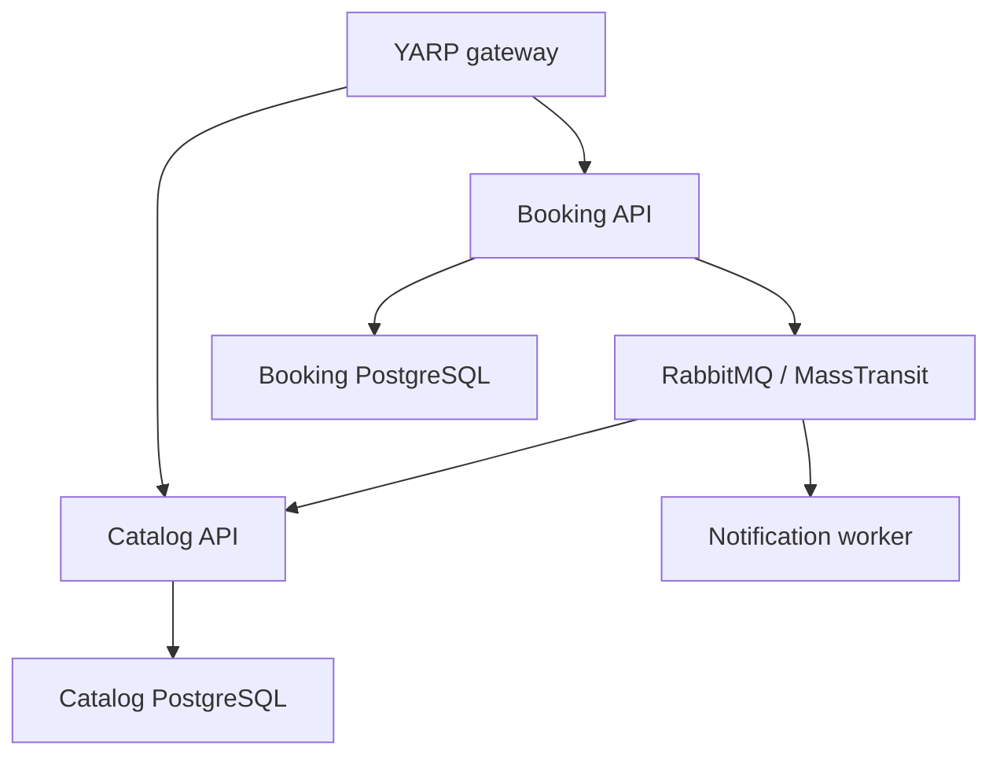

# TicketHub

**An event-driven ticket-booking prototype in .NET.**

ASP.NET Core 8 · PostgreSQL · EF Core · RabbitMQ · MassTransit · YARP

TicketHub explores service boundaries and asynchronous communication: an API gateway routes requests, the booking service persists a pending booking and publishes an event, and separate consumers update catalog inventory and simulate a notification.

## Architecture



| Component | Responsibility | Code |
| --- | --- | --- |
| Gateway | Route `/catalog-service/*` and `/booking-service/*` | [Proxy configuration](ApiGateways/YarpApiGateway/appsettings.json) |
| Catalog | List seeded events and consume booking events to reduce available seats | [Catalog consumer](Services/Catalog/Catalog.API/Consumers/BookingCreatedConsumer.cs) |
| Booking | Store a pending booking, publish `BookingCreatedEvent`, return HTTP 202 | [Booking controller](Services/Booking/Booking.API/Controllers/BookingsController.cs) |
| Notification | Consume the event and log a simulated delivery | [Notification consumer](Services/Notification.Worker/Consumers/BookingCreatedConsumer.cs) |
| Shared contract | Define the event exchanged by services | [BookingCreatedEvent](BuildingBlocks/Messaging.Contracts/BookingCreatedEvent.cs) |

## Run locally

Requirements: .NET 8 SDK, Docker with Compose, and free local ports 5000–5002, 5432–5433, 5672 and 15672.

```bash
git clone https://github.com/bora399/TicketHub.git
cd TicketHub
docker compose up -d
dotnet restore TicketHub.sln
```

Compose starts **PostgreSQL databases and RabbitMQ only**. After those services are ready, start each process in its own terminal from the repository root:

```bash
dotnet run --project Services/Catalog/Catalog.API --launch-profile http
dotnet run --project Services/Booking/Booking.API --launch-profile http
dotnet run --project Services/Notification.Worker
dotnet run --project ApiGateways/YarpApiGateway --launch-profile http
```

Catalog and Booking apply their EF migrations on startup. Catalog seeds two events when its database is empty. The `http` profiles are intentional: they use the ports referenced by the gateway.

| Local endpoint | Purpose |
| --- | --- |
| `http://localhost:5000` | Gateway |
| `http://localhost:5001/swagger` | Catalog API documentation |
| `http://localhost:5002/swagger` | Booking API documentation |
| `http://localhost:15672` | RabbitMQ management (`guest` / `guest` for local development) |

## Demo walkthrough

Use the commands below with `curl` (or `curl.exe` in Windows PowerShell):

```bash
curl http://localhost:5000/catalog-service/api/events
curl -X POST http://localhost:5000/booking-service/api/bookings -H "Content-Type: application/json" -d '{"eventId":"11111111-1111-1111-1111-111111111111","userId":"demo-user","seatCount":1}'
curl http://localhost:5000/booking-service/api/bookings
```

Expected flow: Booking returns **202 Accepted** with `Pending` status; RabbitMQ delivers the event; Catalog reduces the seat count; Notification writes a simulated-delivery log. Fetch events again after the consumer runs to inspect the inventory change. This is a manual demonstration, not an automated test result.

## What this prototype does not guarantee yet

- Booking persistence and event publication are separate writes; an outbox is not implemented.
- Consumers do not yet enforce idempotency or concurrent seat reservations.
- A booking remains `Pending`; there is no confirmation/rejection saga.
- Notifications are log output and a delay; no real email or PDF is sent.
- Authentication, request validation and automated tests are not implemented in this snapshot.

## Next engineering milestones

1. Validate seat counts and derive user identity from authentication.
2. Add a transactional outbox and idempotent consumers.
3. Add reservation concurrency control and a confirmed/rejected booking lifecycle.
4. Test duplicate messages, publish failures, and simultaneous bookings.

These are deliberate follow-up tasks for turning the current messaging exercise into a reliable booking system.
